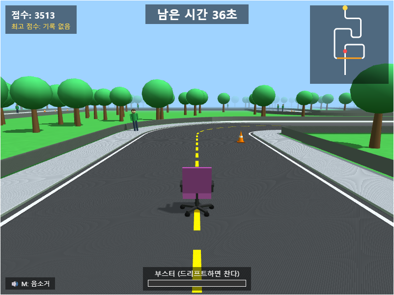

# Chair Drift

바퀴 달린 의자를 탄 대학생이 캠퍼스 도로에서 학생·공사 콘·자동차를 피하며 드리프트해서, 수업에 늦지 않게 강의실까지 달려가는 3D 레이싱 게임

- 학번 / 이름: 202370021 / 유영환

## 플레이하기
👉 https://addboyy.github.io/my-game/

- 2D 버전 (8주차까지 만든 원래 버전): https://addboyy.github.io/my-game/2d/
- **PC에서 키보드로 플레이해 주세요.** (아래 "모바일" 참고)

## 조작법
| 키 | 동작 |
|---|---|
| 아무 키 | 시작 화면에서 시작 |
| ← → / Enter | 트랙 고르기 / 출발 |
| ↑ | 가속 (손을 떼면 서서히 굴러가다 선다) |
| ↓ | 브레이크, 다 서면 후진 |
| ← → | 핸들 (빠를수록 덜 먹는다) |
| Shift + ← → (누른 채로) | 드리프트 — 앞머리를 커브 안쪽으로 꺾은 채 원을 그리며 돈다. 같은 방향키는 깊게, 반대 방향키는 얕게 |
| Shift 떼기 (0.5초 넘게 드리프트한 뒤) | 미니 부스트 |
| Ctrl | 부스터 (드리프트로 게이지가 가득 차면) |
| GO! 순간에 ↑ | 출발 부스터 |
| ↑ + ↓ 같이 → ↓만 떼기 | 번아웃 출발 대시 |
| Esc | 일시 정지 메뉴 (계속 달리기 / 처음부터 다시 / 트랙 선택으로), 트랙 선택 화면에서는 시작 화면으로 |
| R / T | 도착·게임 오버 뒤 같은 트랙 다시 / 트랙 선택으로 |
| M | 음소거 켜고 끄기 (저장됨) |
| D | 디버그 표시 켜고 끄기 |

## 규칙
- **목표:** 제한 시간 안에 트랙 끝의 강의실 문에 도착한다.
- **트랙:** 캠퍼스 산책로(쉬움, 16초) · 고가의 질주(보통, 42초) · 지그재그 캠퍼스(어려움, 33초) + 장애물과 제한 시간이 없는 연습 서킷(한 바퀴마다 랩 시간 기록)
- **장애물:** 횡단보도를 건너는 학생·인도 학생·공사 콘에 부딪히면 잠깐 느려지고, 자동차에 부딪히면 튕겨 나가 잠시 조작할 수 없다. 출발하고 10초마다 자동차가 빨라진다.
- **점수:** 강의실에 도착하면 **남은 시간 × 100**. 트랙마다 최고 점수가 저장된다.
- **게임 오버:** 시간이 다 되면 지각(결석). R로 다시 하거나 T로 다른 트랙을 고른다.

## 모바일
- 휴대폰에서 열면 게임 화면 전체가 화면 폭에 맞게 줄어든다 (가로·세로 모두, 돌리면 다시 맞춘다).
- **터치 조작은 지원하지 않는다.** 방향키 + Shift(드리프트) + Ctrl(부스터)을 같이 누르는 조작이라 터치 버튼으로 옮기기 어려워서, 시작 화면과 이 README에 "PC에서 키보드로 플레이"라고 적었다.

## 개발 환경
- HTML / CSS / JavaScript
- 3D 그리기: Three.js r128 (cdnjs에서 불러옴, 인터넷 연결 필요)
- 소리: Web Audio API (엔진·드리프트·카운트다운 등은 코드로 합성) + 효과음 파일
- 에디터: VS Code (Live Server로 실행)
- 사용한 AI 도구: Claude Code (Anthropic Claude) — 코드 작성, 디버깅, 테스트(실제 브라우저를 화면 없이 띄워 자동으로 눌러 보는 점검), 회고·문서 정리를 함께 했다

## 사용한 에셋
3D (제출 버전)
| 파일 | 용도 | 출처 | 라이선스 |
|---|---|---|---|
| Three.js r128 (`three.min.js`) | 3D 그리기 라이브러리 | cdnjs — https://cdnjs.cloudflare.com/ajax/libs/three.js/r128/three.min.js (https://threejs.org) | MIT |
| images/chair.svg | 시작 화면 의자 그림, 탭 아이콘 | 직접 제작 (SVG) | - |
| 의자·자동차·학생·콘·나무·건물·고가 3D 모델 | 플레이어와 장애물, 배경 | 직접 제작 — Three.js 기본 도형(상자·원기둥·공)을 코드로 조립 | - |
| 잔디·건물 벽·문 무늬 | 바닥과 건물 | 직접 제작 — 코드에서 canvas로 그려서 붙임 | - |
| sounds/crash1.wav, crash2.wav, crash3.wav | 자동차 충돌 (무작위로 하나) | Kenney Impact Sounds — https://kenney.nl/assets/impact-sounds (원래 파일 impactMetal_heavy_000~002.ogg) | CC0 |
| sounds/bump_student.wav | 학생과 부딪힘 | Kenney Impact Sounds (impactSoft_heavy_000.ogg) | CC0 |
| sounds/bump_cone.wav | 공사 콘과 부딪힘 | Kenney Impact Sounds (impactGeneric_light_000.ogg) | CC0 |
| sounds/rail.wav | 가드레일에 세게 부딪힘 | Kenney Impact Sounds (impactMetal_light_000.ogg) | CC0 |
| sounds/ui_move.wav, ui_ok.wav, ui_back.wav | 메뉴 고르기 / 결정 / 닫기 | Kenney Interface Sounds — https://kenney.nl/assets/interface-sounds (select_001, confirmation_001, back_001.ogg) | CC0 |
| 엔진 소리, 드리프트 끽 소리 | 속도에 따라 높낮이가 바뀌는 엔진, 드리프트 중 타이어 | 직접 제작 — Web Audio API로 코드에서 합성 (`createEngineSound`, `updateEngineSound`) | - |
| 카운트다운·GO·부스터·도착·신기록·시간 초과 소리 | 효과음 | 직접 제작 — Web Audio API로 코드에서 합성 (`playSound`) | - |
| screenshot.png | README 게임 화면 | 직접 캡처 | - |

Kenney 효과음은 `.ogg` 파일이라, 아이폰 사파리에서도 나도록 `.wav`(모노 22050Hz)로 바꿔서 넣었다. 소리 자체는 바꾸지 않았다.

2D (`2d/`)
| 파일 | 용도 | 출처 | 라이선스 |
|---|---|---|---|
| images/car.png | 자동차 | Kenney Racing Pack — https://kenney.nl/assets/racing-pack | CC0 |
| images/student.png | 학생 | Kenney Racing Pack — https://kenney.nl/assets/racing-pack | CC0 |
| images/grass.png | 잔디 바닥 | Kenney Racing Pack — https://kenney.nl/assets/racing-pack | CC0 |
| images/tree.png | 나무 | Kenney Racing Pack — https://kenney.nl/assets/racing-pack | CC0 |
| images/chair.svg | 의자 (플레이어), 탭 아이콘 | 직접 제작 (SVG) | - |
| 효과음 전부 | 효과음 | 직접 제작 — Web Audio API로 코드에서 합성 | - |
| 도로·건물·콘·구름·미니맵 등 나머지 | 배경과 장애물 | 직접 제작 (canvas 도형) | - |

## 제작 과정
10주 동안 매주 한 단계씩 쌓아 만들었습니다. 자세한 기록은 아래 파일을 참고하세요.
- [회고.md](회고.md) — 10주 전체 회고와 주차별 회고
- [기획서.md](기획서.md) — 3주차 기획
- [디버깅기록.md](디버깅기록.md) — 7주차 버그 해결 기록과 핵심 코드 설명 (`debug-practice.html`은 7주차 숨은 버그 찾기 연습 파일)
- [플레이테스트.md](플레이테스트.md) — 9주차 플레이테스트 2명과 반영 내역
- [테스트목록.md](테스트목록.md) — 최종 점검 목록

| 주차 | 한 것 |
|---|---|
| 1 | 자기소개 페이지 |
| 2 | GitHub 배포 |
| 3 | 게임 화면 그리기 |
| 4 | 게임 루프 (자동차·학생이 움직이고 남은 시간이 준다) |
| 5 | 조작 (방향키, Shift 드리프트·타이어 자국, 추격 시점 카메라, 고가도로 트랙, 미니맵, 역주행 경고) |
| 6 | 규칙 (장애물 배열, 충돌 판정, 슬로우·스턴, 제한 시간, 도착 점수, 게임 오버와 R 키 재시작) |
| 7 | 디버깅 (숨은 버그 3개, D 키 디버그 표시, 탭 전환 시간 버그 수정, 코드 6구역 정리) |
| 8 | 게임답게 (시작 화면, 효과음·음소거, 난이도 곡선, 트랙 재조정, 카트식 조작감·드리프트, 연습 서킷, Esc 메뉴) |
| 9 | 다듬기 (제출 버전을 3D로, 플레이테스트 2명 → 장애물 20% 줄이기·효과음 보강, 자동차 겹침 수정, 휴대폰 화면 맞추기, 키 확인 중복 제거) |
| 10 | 완성 (시크릿 모드·휴대폰 크기 최종 점검, README, 10주 회고, 발표 준비) |

### 2D에서 3D로 바꾼 이유
8주차까지는 Canvas로 위에서 내려다보는 2D 게임을 만들었고, 같은 게임 규칙으로 Three.js 3D 버전도 따로 만들어 왔다.
직접 해 보니 3D가 더 좋아서 9주차부터 3D를 제출 버전으로 바꿨다. 게임 규칙(트랙, 조작, 드리프트, 충돌, 시간, 점수)은 2D 코드를 그대로 쓰고, 그리기만 3D다.
1~7주차 회고와 디버깅기록.md의 줄 번호는 2D 코드(`2d/script.js`) 기준이다.

| | 2D (`2d/`) | 3D (제출 버전) |
|---|---|---|
| 그리기 | Canvas `ctx` | Three.js 라이브러리 |
| 의자·자동차·학생·나무 | 그림 파일 | 상자·원기둥·공을 조립한 3D 모델 |
| 고가도로 | 그림자와 반투명으로 흉내 | 진짜 높이, 오르막·내리막, 기둥 |
| 카메라 | 위에서 내려다보며 회전 | 의자 뒤에서 따라가는 3인칭 |
| 화면 위 글자 | Canvas에 그림 | HTML 글자를 3D 화면 위에 겹침 |
| 계산 속도 | 화면 한 번 그릴 때 한 번 | 실제 시간으로 1초에 60번 (어느 컴퓨터든 같은 속도) |

### 게임 아이디어
1번 아이디어 Chair Drift (체어 드리프트) 로 선정했다.
제일 간단하고 내가 좋아하는 레이싱 게임을 만들 수 있을것 같아서 선정했다.

## 앞으로 하고 싶은 것
- [ ] 어려움 트랙 제한 시간 다시 맞추기 — 플레이테스트에서 "한번 부딪히면 회생할 기회가 없었다"는 말을 들었다 (플레이테스트.md 2순위)
- [ ] 휴대폰 터치 조작 (화면에 방향·드리프트·부스터 버튼)
- [ ] 3D에서도 판정 영역(히트박스) 테두리 보기 — 지금은 2D에서만 그린다
- [ ] 친구들과 기록을 겨루는 온라인 랭킹 (지금 최고 점수는 내 브라우저에만 저장된다)
- [ ] 트랙 더 만들기
